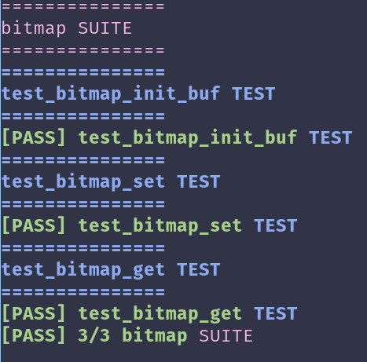

# Waddle OS -- 3

This is the third in my WaddleOS series of posts. I'm going to try to write a little more technically about what I'm doing instead of doing a project update format like the last post, to keep it more interesting for the reader.

The to-do list set up from last time was as follows:
- Implement heap
- Implement testing infrastructure (primarily for the heap)
- Implement logging library
- Implement scheduler

## Logging Library

This was pretty easy to set up, as a former TA at UT had included a very convenient `log.h` header file that I just made a couple changes to and included here.

## Directory Structure and Build Setup

In addition, I'm adding another bullet:

- Change directory and build setup

What do I mean by this? Well, my previous directory structure was absolute garbage:

```
kernel
├── bitmap.c
├── bitmap.h
├── heap.c
├── heap.h
├── idt.c
├── idt.h
├── interrupts.c
├── interrupts.h
├── interrupt_stubs.S
├── io.h
├── linker.ld
├── log.h
├── main.c
├── multiboot2.h
├── multiboot_parser.c
├── multiboot_parser.h
├── paging.c
├── paging.h
├── pic.c
├── pic.h
├── pit.c
├── pit.h
├── printf.c
├── printf.h
├── scheduler.c
├── scheduler.h
├── serial.c
├── serial.h
├── startup.S
├── string.c
├── string.h
├── term.c
├── term.h
└── utils.h
loader
├── boot0.S
└── boot1
    ├── boot1.asm
    ├── boot1.S
    ├── constants.h
    ├── elf.h
    ├── io.h
    ├── linker.ld
    ├── log.h
    ├── main.c
    ├── multiboot2.h
    ├── printf.c
    ├── printf.h
    ├── serial.c
    ├── serial.h
    ├── string.c
    ├── string.h
    ├── term.c
    └── term.h
```

No structure at all! On top of that, my brilliant design decision was to use a bunch of hardlinks to files in `kernel/` inside my `loader/boot1` to share code. I have no idea why I did this. This is why you see the same drivers twice in both kernel and loader.

Here's the new directory structure:
```
kernel
├── drivers
│   ├── bitmap.c
│   ├── bitmap.h
│   ├── idt.c
│   ├── idt.h
│   ├── interrupts.c
│   ├── interrupts.h
│   ├── interrupt_stubs.S
│   ├── multiboot_parser.c
│   ├── multiboot_parser.h
│   ├── pic.c
│   ├── pic.h
│   ├── pit.c
│   └── pit.h
├── linker.ld
├── main.c
├── mem
│   ├── heap.c
│   ├── heap.h
│   ├── paging.c
│   └── paging.h
├── sched
│   ├── scheduler.c
│   └── scheduler.h
└── startup.S
loader
├── boot0.S
└── boot1
    ├── boot1.asm
    ├── boot1.S
    ├── constants.h
    ├── linker.ld
    └── main.c
lib
├── elf.h
├── io.h
├── log.h
├── multiboot2.h
├── printf.c
├── printf.h
├── serial.c
├── serial.h
├── string.c
├── string.h
├── term.c
├── term.h
└── utils.h
```

A new folder, `lib`, addresses the issue of shared files. 

My initial idea for this folder would be that it builds a statically linked library, `libwaddle.a`, that would then be shared by kernel and bootloader. It was only after I implemented this that I realized that my bootloader was 32-bit, and my kernel was 64-bit, meaning I would have to compile two different versions of the library in order to use it.

So I just integrated the `lib` folder to be directly compiled into both the kernel and the bootloader. After a lot of fiddling with the Makefile, I was able to get it working!

## The Heap

*Preliminary Research:*
- [this series on memory allocation strategies](https://www.gingerbill.org/series/memory-allocation-strategies)
- [heap basics](https://www.youtube.com/watch?v=5zvu7vyypt0)
- [dlmalloc](https://gee.cs.oswego.edu/dl/html/malloc.html)
- [article explaining dlmalloc](https://techlifecompilation.wordpress.com/2018/10/04/malloc1-heap-exploitation-101/)

As I go through a lot of these articles, the concept of "bins" or fastbins stands out as something extra from what I know from my Software Design I class. The basic implementation of the heap is what I'm going to try first, and then implementing this concept of different bins for faster access than one long freelist seems like a good goal.

As always, I got sidetracked. I spent a little bit setting up a `free_hdr_t` and `alloc_hdr_t` structs, but then realized I had nowhere to put my memory.

My `paging` module from the previous post has one large flaw: I can only allocate one page at any given point. In other words, `paging_get_page` only gets one page. I want to be able to allocate a kernel heap for any other kernel data structures, which means I'm going to inevitably need more than a page.

`paging_get_page` is built on top of `bitmap_test_and_flip`, which I wrote based on `bitmap_scan_and_flip` in PintOS (but I'm trying to not cheat too much). It finds the first bit of value `value` and flips it, using the `ctzll` (count trailing zeros) builtin in GCC, which links to the assembly instruction that fulfills the same purpose.

### Bitmap

Rewriting `bitmap_test_and_flip` to support multiple contiguous bits and a start bit in an efficient way became a primary focus. I wrote some helper bitmap functions that perform `bitmap_test` and `bitmap_flip` as well.

In doing so, I realized that it was time to incorporate something I have been putting on the back-burner for a while: a testing framework.

#### Test Framework

A simple test framework where I can run some setup, test, and teardown. I could use something like CUnit, Unity, etc. Or I could develop my own. If you've been following my line of thinking throughout this series, I like developing things on my own.

Additionally, since we don't have user programs integrated into the OS yet, the unit tests will currently be run on the host system until that integration is set up. I'll compile with the host `gcc` and pass in all the same flags.

The considerations I made about the testing framework were as follows:
- Must automatically generate a test runner for the tests I specify on the command line
- Must allow me to run any subset of valid tests
- Must generate a report showing passing/failing assertions

I initially made an attempt at writing a purely Makefile and GCC based testing framework, but it was really bad. I tried using OBJDUMP to get the tests in a given file, and do some fancy shit with parametrically generated Makefile targets, but it was too convoluted for my liking. Switching over to Python allowed me to debug and implement far easier.

It was cool to learn about the Makefile `define` keyword though. Just like any other language, you can `define` certain sections of a Makefile and run a `foreach` function, filling in the contents of the `define` with a different parameter as it's expanded out. I'm not doing a great job of explaining how it works, so here's the example I used in my test framework.

```
define GET_TEST_SRCS
$(shell \
    if [ -f $(1)/test.cfg ]; then \
        source $(1)/test.cfg; \
        for f in $$TEST_SRCS; do echo $$f; done; \
    fi)
endef
```

For a given $(1) (parameter), this will source and echo the TEST_SRCS defined in test.cfg for that directory.

I also used `jinja2` to incorporate some simple templating into the framework, so that I didn't have to autogenerate the full `test_main.c` and could just fill in certain constants. All this to say, my test framework does the following:
- Takes in a list of test "suites" via Makefile (or by default, runs all available). A test suite is simply one folder in the test directory, associated with one or more "tests" which are any and all functions that appear in source files inside that test directory.
- Filters out invalid test suites.
- Enumerate all the source files in valid test suites, and pass to `test_gen.py`.
- `test_gen.py` will generate metadata for each test suite, the list of test structs to run (each test struct has a name, a setup function, and a test function), and a few other constants necessary for `test_main.c` to compile.
- After `test_main.c` is generated in `build/test/gen`, it will be compiled in with the appropriate kernel sources (pulled from `test.cfg` in the test suite folder) and the `test_*.c` tests themselves, and then run.

It generates a pretty report too!



Finally, this was my first opportunity to try out `uv`, the hyped-up replacement for `pip`. I have to say, it's pretty nice to be able to `uv run` stuff with it without having to start up my venv, and the installation times blow `pip` out of the water.

-----

After creating this test infrastructure, I spent weeks trying to fine-tune a `bitmap_test` method in the most efficient manner possible. I realized quickly that it was too prohibitively time consuming, so I just replaced it with a default implementation that went bit-by-bit without any of the cool tricks like `ctz` or `popcount`.

The tricks I'm referring to here are the GNU provided builtin methods that allow you to run optimized (sometimes even one instruction) assembly for a particular purpose. In this case, the [GCC Bit Operation Builtins](https://gcc.gnu.org/onlinedocs/gcc/Bit-Operation-Builtins.html) are particularly awesome, and I was able to successfully use them for `bitmap_flip`, but decided it was too annoying to get it to work for `bitmap_test` or `bitmap_test_and_flip`. 

This is an important lesson: *trying to hyper-optimize something that never worked in the first place (and without a whiteboard at hand) leads to a huge waste of time.*

Having unit tests to verify logic was incredibly beneficial though. I can even add these to GH Actions to run on push for regression testing.

I also did this for `memset` and `memmove` (`memcpy`), where I was experiencing correctness issues because I tried to hyper-optimize everything poorly.

-----

I finished my heap implementation. I think upgrading to fastbins and arenas is a task for the future, as I'm trying to get the basic OS up and running and there's still a lot to do. And if I've learned anything, a shittier/less-performant but _known working_ implementation is better to have before optimizing.

-----

After this, I fixed my page allocator as I realized it had plenty of bugs. I'm not going to go in depth on every single one, but the most interesting one was how I had set up my page pool mechanism initially.

At first, I thought I could allocate the bitmap and the page pool consecutively, like so:

> | md |           page_pool           |

(the page_pool is the actual location of the pages being allocated, and the md is the tracking mechanism, i.e. a bitmap)

However, I quickly realized this was not viable due to how my bootloader sets up memory initially. Basically, if I had allocated it like the above picture, my kernel and user pools would have been sequential, like so:

> | bldr | k_code | k_md |           k_page_pool           | u_md |           u_page_pool           |

The problem with this is that I need the bitmap to be mapped in order to grab pages from the pool. Since my bootloader only higher-half maps the first 2MB of space, the u_md would not be mapped and I would have to go out of my way to add a mapping for it separately. So, I restructured my pools to allow for an arbitrary md location and page_pool location. Now, my metadata all (hopefully) fits in the first 2MB:

> | bldr | k_code | k_md | u_md |           k_page_pool           |           u_page_pool           |
> ----- FIRST TWO MEGABYTES ------

A significant problem is what to do when k_code grows and pushes metadata out of the first two megabytes. Since my page mapping relies on the bitmaps to be working properly, I'm not really sure what to do in this case. It's a chicken-and-egg problem: I need to grab pages to put page table data into, but in order to do that I need to have a working bitmap, which requires some mapped pages, which requires a working page allocator. I might use fixed positions for the page tables or something... but I'm going to start work on the scheduler first.

## Scheduler
I really missed out in my OS class by not building a scheduler. I did so in Real-Time Embedded Systems, but it was limited to round robin and priority-based schedulers. My goal here is to be able to build a plug-n-play scheduler with whatever scheduling policy I want, so I can later run workloads and compare performance.

Before all of that, I aim to implement a simple, cooperative scheduler. Even though I have the tick interrupt working, I'll leave round robin and other preemptive schedulers for later.

Each thread needs to have a TCB, stored in kernel memory. The TCB contains important information associated with a thread, like the status of the thread, the TID, and the saved stack pointer. The thread is the most primitive scheduling unit of the kernel. Each thread has a user stack for the user's context and function calls, but also a kernel stack for storing information when the kernel executes privileged code on behalf of the user.

Since Pintos is what I know and what I'm referencing while building this, I'll structure it similarly. Here's a visual diagram taken from `thread.h`:
```
 *      4 kB +---------------------------------+
 *           |          kernel stack           |
 *           |                |                |
 *           |                |                |
 *           |                V                |
 *           |         grows downward          |
 *           |                                 |
 *           |                                 |
 *           |                                 |
 *           |                                 |
 *           |                                 |
 *           |                                 |
 *           |                                 |
 *           |                                 |
 *           +---------------------------------+
 *           |              magic              |
 *           |                :                |
 *           |                :                |
 *           |               name              |
 *           |              status             |
 *      0 kB +---------------------------------+
```

As you can see, the kernel stack grows towards the TCB and all of it is contained in a single page. You can also see a magic number is being stored in the TCB. This is for detecting stack overflow with assertions, and is one of the upsides of storing your TCBs like this. Another upside is being able to mask out bits from the current stack pointer to derive the base of the TCB.

Here's my .bss declared in my linker script:
```
  /* Read-write data uninitialized; stack */
  .bss : AT(ADDR(.bss) + LMA_OFS)
  {
    _bss_start = .;
    *(COMMON)
    *(.bss*)
    _bss_end = .;

    . = ALIGN(4096);
    _stack_bottom = .;
    . += 4K;
    _stack_top = .;
  } 
```
To initialize the threading system, we have to transform the current code into an "initial thread". This basically just means we get the top of the page that our initial stack is aligned to, and start setting variables there.

Next, we need to maintain the running thread and the ready list. Thus, we need a list data structure. Both [Linux](https://docs.kernel.org/core-api/list.html) and Pintos use a list_node structure embedded within the desired payload, which I think is very creative. It's known as the [container_of](https://docs.kernel.org/driver-api/basics.html#c.container_of) paradigm.
